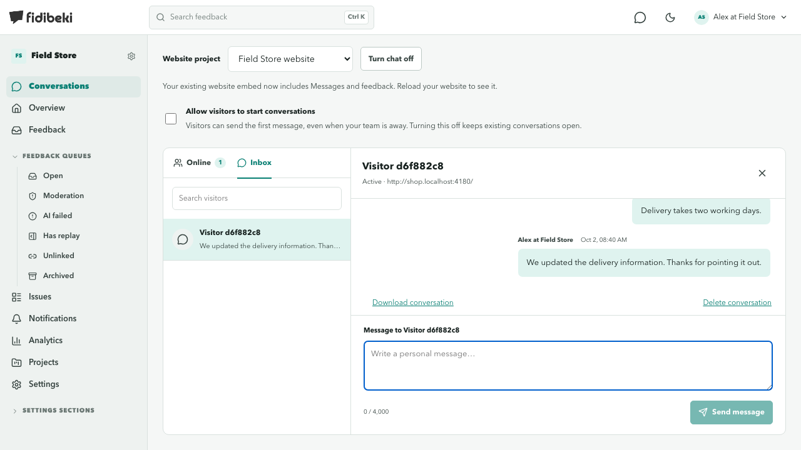
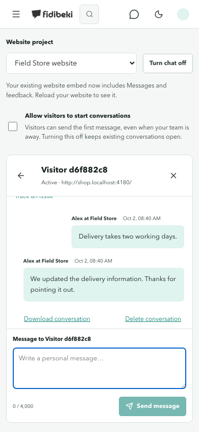

# Website conversations linked to issues

A tenant operator can select a visitor message and create an issue or associate an existing issue in the same project. The operator writes the issue title and optional summary. The original conversation stays linked; the transcript is not copied into the issue. Several messages and conversations can support one issue. The chat displays each linked issue once with its current status.

The issue page links back to its source conversations, including sources belonging to merged issues. After resolving an issue, the operator returns to chat and sends a reply explicitly. Internal comments, issue summaries and status changes are never posted to visitors automatically. Chat sessions must still be valid for replies. Existing consented reporter email updates are separate.

## Access and storage

Migration 141 adds `website_chat_issue_links` with tenant/project/message/issue foreign keys and operator-only, project-scoped RLS. Bridge reads require `chat:read`, `project:read` and `issue:read`; mutations also require `chat:write` and `issue:update`. Current membership permissions are authoritative, including after permission revocation. API keys are not accepted for website chat.

A source message can reference one issue. The visitor row serializes create/link/unlink operations, and a canonical request hash makes identical retries idempotent while conflicting requests return 409. Issue creation, numbering, activity, outbox event and conversation reference commit in one transaction. Existing merged issues reject new links.

Links contain references, not message bodies. Deleting a conversation or issue cascades its links. Removing a link preserves both records. An operator-authored summary remains with its issue after the conversation is deleted. Scheduled conversation cleanup applies after 180 days without new messages, subject to legal holds. A 128 KiB body bound accommodates the 10,000-character summary limit, including JSON-escaped Unicode; other chat requests retain their existing 20,000-byte limit.

## Operator endpoints

Under `/v1/projects/{projectID}/chat`:

- `GET /visitors/{visitorID}/issues`: linked issue summaries, up to 500 references.
- `POST /visitors/{visitorID}/issues`: `message_id` and either `issue_id` or `title` plus optional `description`.
- `DELETE /visitors/{visitorID}/issues/{messageID}`: remove the reference only.
- `GET /issues/{issueID}/conversations`: source conversations, including merged issue sources, up to 500 conversations.

Bounded lists return `truncated` when more references exist. Widget routes and public thread responses remain unchanged.

## Verification, 2 October 2026

- PostgreSQL/Redis integration tests under the real `fidibeki_app` RLS role: permission revocation, wrong project/tenant, missing source, invalid inputs, idempotent retries, merged issues, public scope isolation, deletion cascade, Unicode summary limits and migration up/down/up.
- Eight desktop/mobile conversation browser tests: create/link/remove, failure with preserved draft, existing-issue filtering, duplicate summary suppression, read-only permissions and navigation from issue back to the selected conversation.
- Two complete support journeys with real local PostgreSQL, Redis, Go API, Nuxt proxies and the built website widget. The website journey creates an issue, resolves it with an internal note, verifies no implicit visitor message, returns to chat and confirms delivery of the explicit reply.
- Tenant frontend typecheck and 197 unit tests.
- Marketing has 45 pages in each of four languages, generated HTML/Markdown, canonical and reciprocal language links, sitemap and updated `llms.txt`. Comparison copy distinguishes documented overlap from the positioning hypothesis.

The independent finish review found duplicate summary rows, a Unicode request-size mismatch and inaccurate retention wording. All three were corrected before release.

