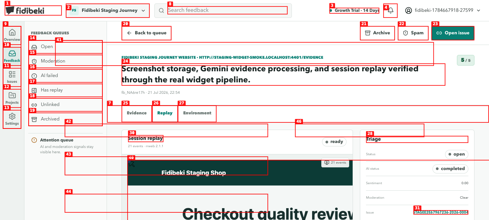
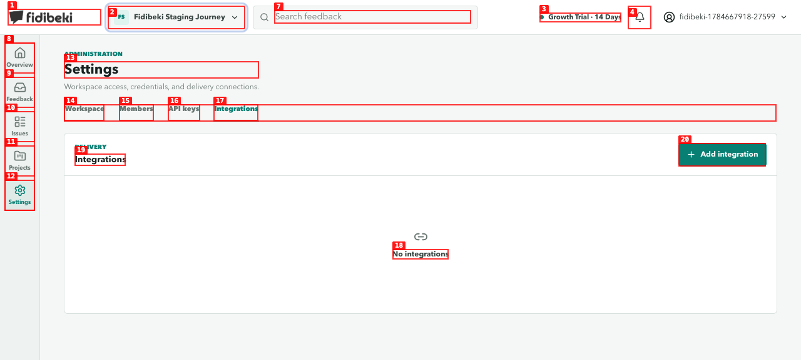
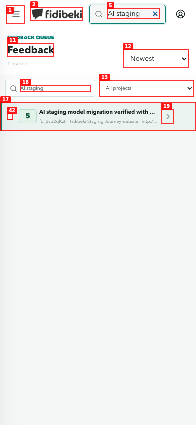
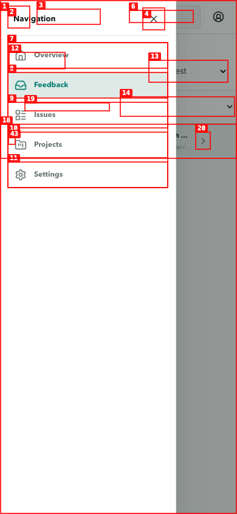
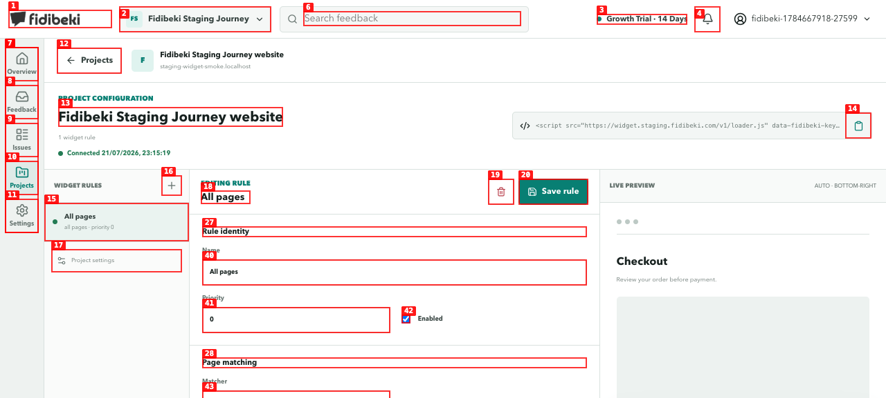
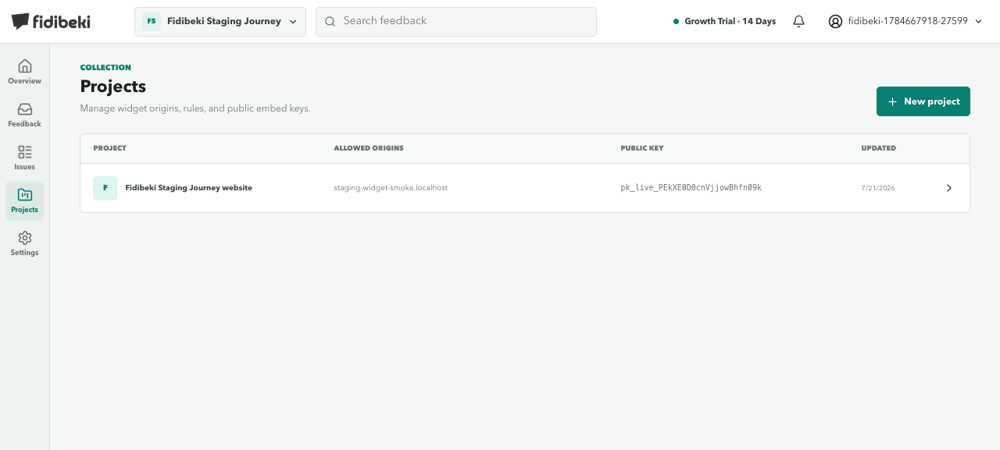
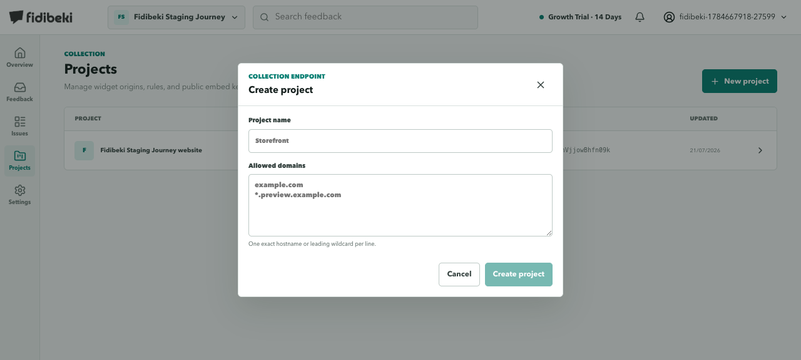
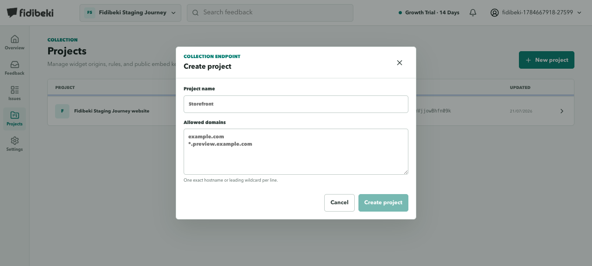

# Dogfood Report: Fidibeki Staging

| Field | Value |
|-------|-------|
| **Date** | 2026-07-21 |
| **App URL** | https://stagee2e67967236.staging.fidibeki.com |
| **Session** | fidibeki-staging-dogfood |
| **Scope** | Authenticated workspace, all primary navigation areas, desktop and mobile |

## Summary

| Severity | Count |
|----------|-------|
| Critical | 0 |
| High | 0 |
| Medium | 3 |
| Low | 3 |
| **Total** | **6** |

All six findings were resolved in commit `6eb441c` and rechecked on the staging web deployment
`94fa8e19-b388-422f-8884-c734564ef4c7`. Open findings after verification: **0**.

## Resolution Verification

| Issue | Result | Staging verification |
|-------|--------|----------------------|
| ISSUE-001 | Resolved | Replay play/pause, fullscreen, and skip-inactive controls expose accessible names. |
| ISSUE-002 | Resolved | Native modal focuses the first input, closes with `Escape`, and returns focus to **New project**. |
| ISSUE-003 | Resolved | A clean Settings reload with browser locale `en-GB` produced no hydration or console errors. |
| ISSUE-004 | Resolved | Closed mobile navigation is absent from the accessibility tree; open drawer focuses its close control, makes the page inert, and returns focus on `Escape`. |
| ISSUE-005 | Resolved | Workspace control links to Settings and the inactive notification control was removed. |
| ISSUE-006 | Resolved | The rule delete control is exposed as **Delete rule**. |

### Storage attachment follow-up

The reported staging attachment failure could not be reproduced after the storage CORS fix. A real
widget submission created `fb_r4S07QHh` with both attachments present:

| Attachment | Stored bytes | Processing | Read verification |
|------------|-------------:|------------|-------------------|
| Screenshot (`image/png`) | 27,385 | completed, no error | Loaded in the platform at 1280x720. |
| Audio (`audio/webm`) | 17,796 | completed, no error | Loaded in the platform with media `readyState=4`. |

The controlled rule's audio capability was enabled only for this submission and restored to its
previous disabled state afterward. The temporary QA login address was also restored.

## Issues

### ISSUE-001: Replay controls have no accessible names

| Field | Value |
|-------|-------|
| **Severity** | low |
| **Category** | accessibility |
| **URL** | `/feedback/056a797a-09f7-4659-9ecb-a13cbc174843` |
| **Repro Video** | N/A |

**Description**

The session replay player renders multiple interactive controls as unnamed buttons and an unnamed
checkbox. Screen-reader and voice-control users cannot determine which control plays the replay,
skips events, toggles interaction display, or enters fullscreen. Speed controls are named correctly.

**Repro Steps**

1. Open the verified feedback and select the **Replay** tab.
2. Inspect the player controls with the accessibility tree.
3. **Observe:** controls 33, 38, and 39 have no accessible name.
   

---

### ISSUE-006: Delete-rule icon button has no accessible name

| Field | Value |
|-------|-------|
| **Severity** | low |
| **Category** | accessibility |
| **URL** | `/projects/6ce9d007-52fd-4114-a9d6-316dd378cb01` |
| **Repro Video** | N/A |

**Description**

The destructive trash icon beside **Save rule** is exposed only as an unnamed button. Its purpose
and destructive nature are unavailable to screen-reader and voice-control users.

**Repro Steps**

1. Open an existing project rule.
2. Inspect the editor toolbar with the accessibility tree.
3. **Observe:** control 19 is an unnamed button.
   

---

### ISSUE-005: Workspace selector and notification bell are inert controls

| Field | Value |
|-------|-------|
| **Severity** | low |
| **Category** | functional / ux |
| **URL** | Any authenticated desktop page |
| **Repro Video** | N/A |

**Description**

The workspace name is rendered as a button with a chevron and the header includes a notification
button, but activating either control only changes focus. No menu, status message, navigation, or
other response is provided, creating two persistent false affordances in the global header.

**Repro Steps**

1. Open any authenticated page at desktop width.
2. Select the workspace-name button, then select the notification bell.
3. **Observe:** both controls remain focused but perform no action.
   

---

### ISSUE-004: Mobile navigation exposes hidden and background controls

| Field | Value |
|-------|-------|
| **Severity** | medium |
| **Category** | accessibility / ux |
| **URL** | `/feedback?q=AI+staging` at 390x844 |
| **Repro Video** | N/A |

**Description**

When the mobile navigation is closed, its close button and all navigation links remain exposed to
assistive technology. When opened, the accessibility tree exposes the original **Open navigation**
button, two **Close navigation** buttons, the drawer links, and all underlying page controls at once.
Focus is not moved into or contained by the drawer.

**Repro Steps**

1. Open Feedback at a 390x844 viewport.
   
2. Select **Open navigation**.
3. **Observe:** hidden, duplicate, and background controls are all available simultaneously.
   

---

### ISSUE-003: Authenticated pages hydrate with mismatched markup

| Field | Value |
|-------|-------|
| **Severity** | medium |
| **Category** | console / functional |
| **URL** | `/projects/6ce9d007-52fd-4114-a9d6-316dd378cb01`, `/settings` |
| **Repro Video** | N/A |

**Description**

Clean reloads of multiple authenticated pages log `Hydration completed but contains mismatches.`
The pages are initially usable, but the server and client render different DOM, which can cause stale
state, lost event handlers, or layout changes as Vue repairs the app shell.

**Repro Steps**

1. Navigate to the project rule editor or Settings.
2. Clear the browser console and reload the document.
3. **Observe:** Vue emits the hydration-mismatch error again.
   

---

### ISSUE-002: Create-project modal does not manage keyboard focus

| Field | Value |
|-------|-------|
| **Severity** | medium |
| **Category** | accessibility / ux |
| **URL** | `/projects` |
| **Repro Video** | Unavailable: local browser recorder could not find `ffmpeg` |

**Description**

The create-project overlay is not exposed as a modal dialog, does not move focus into the form,
does not trap focus, and does not close on `Escape`. After opening it, focus remains on the opener;
the first `Tab` moves to the project link behind the overlay instead of the project-name field.

**Repro Steps**

1. Open **Projects**.
   
2. Select **New project**.
   
3. Press `Tab`, then `Escape`.
   
4. **Observe:** the overlay remains open and keyboard focus is outside the modal form.

---
