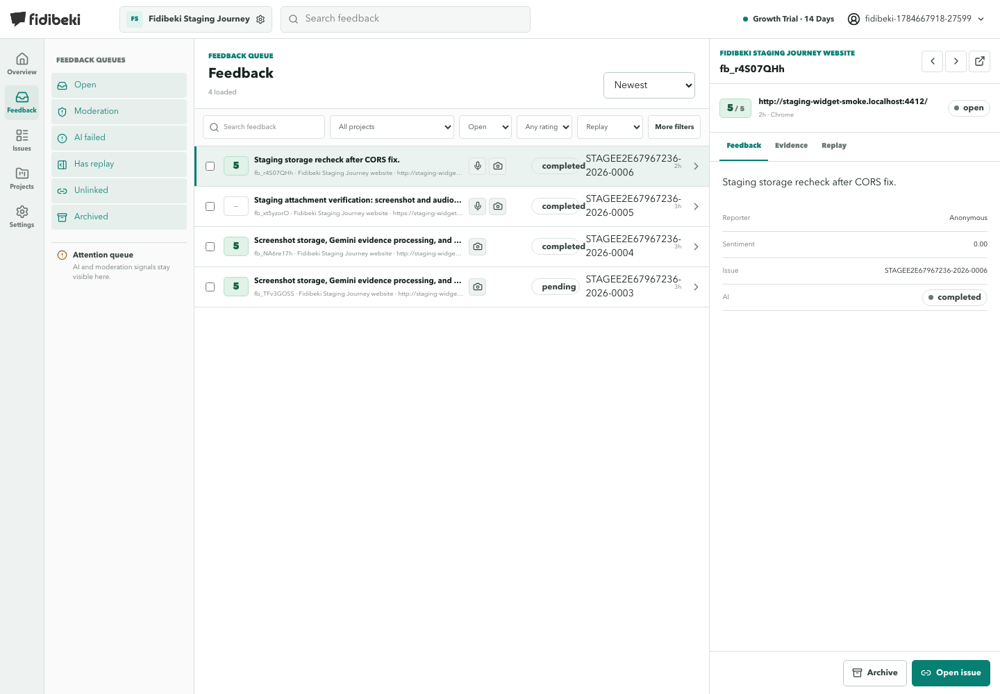
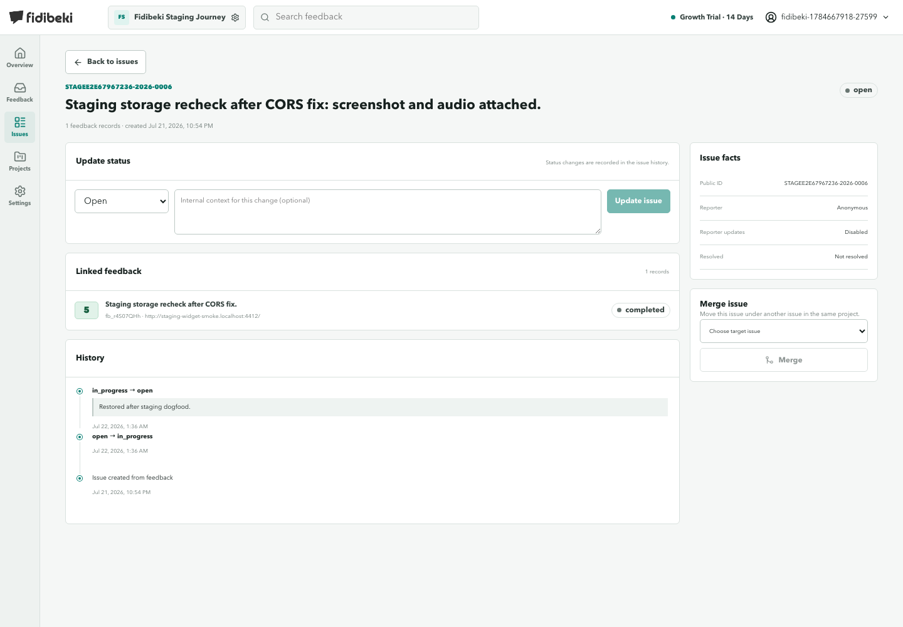

# Dogfood Report: Fidibeki Staging

| Field | Value |
|-------|-------|
| **Date** | 2026-07-22 |
| **App URL** | https://stagee2e67967236.staging.fidibeki.com |
| **Session** | fidibeki-staging-dogfood-20260722 |
| **Scope** | Authenticated workspace, desktop and mobile |

## Summary

| Severity | Count |
|----------|-------|
| Critical | 0 |
| High | 0 |
| Medium | 1 |
| Low | 1 |
| **Total** | **2** |

Both findings are fixed in the accompanying change and covered by regression tests. Staging
verification is pending deployment.

## Issues

### ISSUE-001: Feedback queue links leave filters and results stale

| Field | Value |
|-------|-------|
| **Severity** | medium |
| **Category** | functional / navigation |
| **URL** | `/feedback?attachment=replay`, `/feedback?status=archived` |
| **Repro Video** | N/A |

**Description**

Selecting a feedback queue in the persistent sidebar changes the browser URL but does not update
the filter controls or fetch the corresponding results. A full document reload applies the URL
parameters correctly. This makes queue navigation appear successful while showing records from the
previous queue.

**Repro Steps**

1. Open `/feedback?attachment=replay` and confirm that **Evidence filter** is **Replay**.
2. Select **Archived** in the feedback-queue sidebar.
3. **Observe:** the URL changes to `/feedback?status=archived`, but **Status filter** remains **Open**,
   **Evidence filter** remains **Replay**, and the same four records remain loaded.
   
4. Reload the document and observe that the Archived filter and results are then applied.

The same stale-navigation behavior was reproduced from the default Open queue to **Has replay**.

**Resolution:** Fixed locally. Route changes now synchronize every queue filter without a document
reload while preserving local **All** and **Clear filters** choices. Regression coverage verifies
queue navigation, clean URLs, result updates, and the absence of document reloads.

---

### ISSUE-002: Issue detail uses plural copy for a single feedback record

| Field | Value |
|-------|-------|
| **Severity** | low |
| **Category** | content / ux |
| **URL** | `/issues/7e4ffdf4-2674-493c-996d-50109ca1c698` |
| **Repro Video** | N/A |

**Description**

An issue linked to one feedback record is described as **1 feedback records** in the page header and
**1 records** in the Linked feedback section. The incorrect pluralization makes the operational
summary read as unfinished copy.

**Repro Steps**

1. Open an issue linked to exactly one feedback record.
2. **Observe:** the page shows **1 feedback records** and **1 records** instead of singular forms.
   

**Resolution:** Fixed locally. Both counts now use the singular form when exactly one record is
linked, with regression coverage for the issue detail view.

---
